# Logra · FPGA Studio

**English** · [Русский](README.ru.md)

A browser-based learning studio for the **Sipeed Tang Nano 20K** board. It walks a beginner
through the whole path: write Verilog or draw a schematic, see the circuit, check it on a
timing diagram, build it on a virtual lab bench with parts, and load it into a real board.

No vendor IDE is needed: synthesis, place-and-route and simulation are done by open tools —
Yosys, nextpnr, Project Apicula and Icarus Verilog.

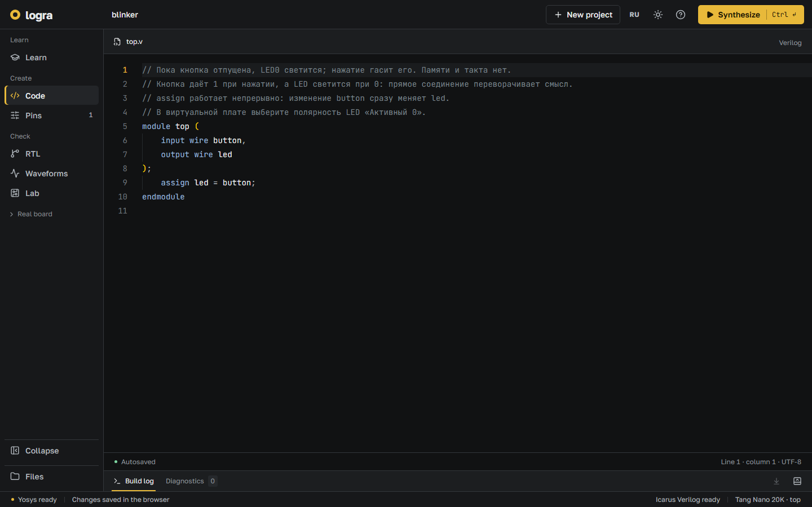

## What is inside

| Tab           | What you do there                                                                       |
| ------------- | --------------------------------------------------------------------------------------- |
| **Learn**     | A course for people who see an FPGA for the first time: short steps, quizzes, checks    |
| **Code**      | A Verilog editor with live error checking and project files                             |
| **Designer**  | Build a schematic from logic blocks with the mouse; it is turned into Verilog           |
| **Pins**      | Assign ports to the pins of the QN88 package, labelled as in the chip documentation     |
| **RTL**       | The schematic of logic elements after synthesis; jump from an element to its code line  |
| **Waveforms** | Timing diagrams: an input scenario, a cursor, checks of expected values                 |
| **Lab**       | The board on a desk: parts, wires and your circuit running in real time                 |
| **Gowin**     | The real chip primitives: LUTs, flip-flops, arithmetic blocks                           |
| **Chip**      | nextpnr placement and routing, the usage map, the frequency report, the `.fs` bitstream |
| **Connect**   | Load the bitstream into the board straight from the browser over WebUSB, UART terminal  |

<table>
  <tr>
    <td>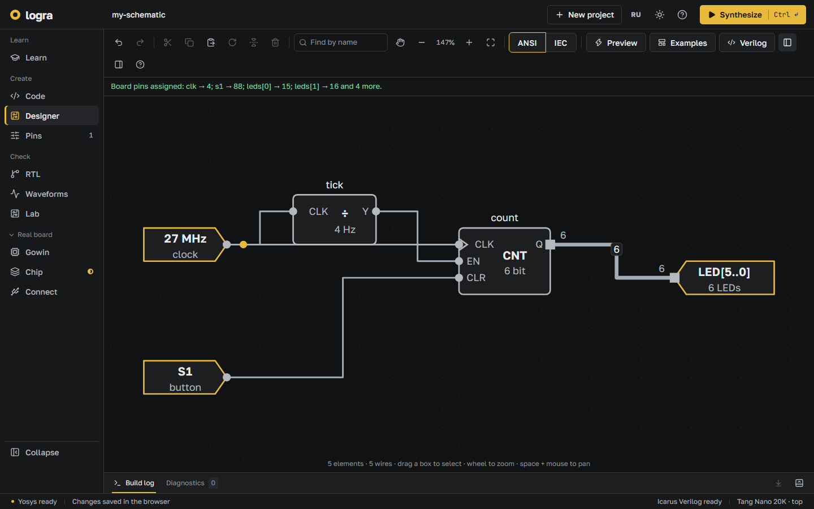</td>
    <td>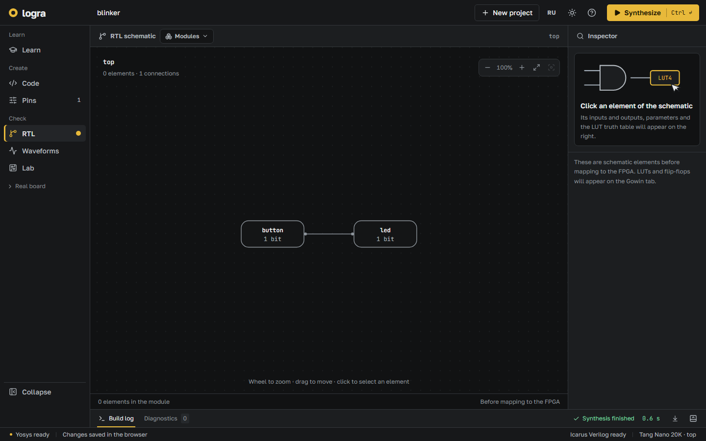</td>
  </tr>
  <tr>
    <td>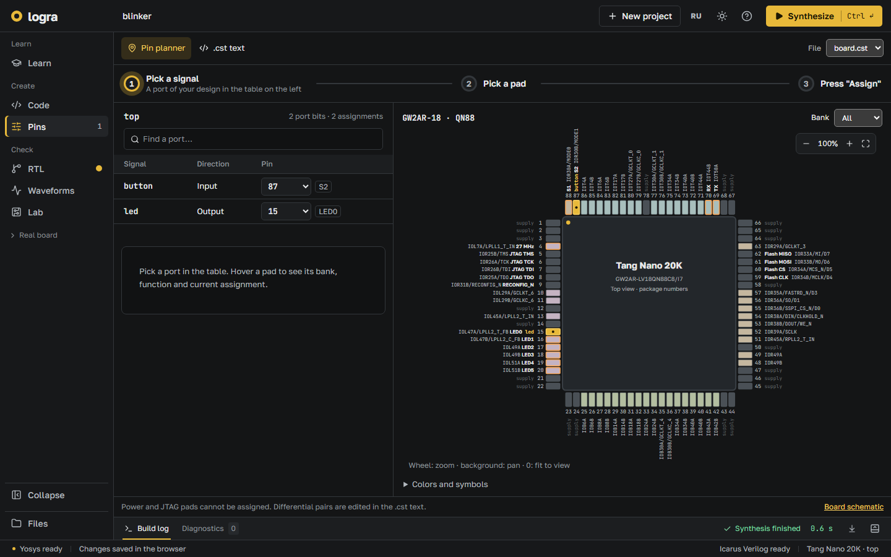</td>
    <td>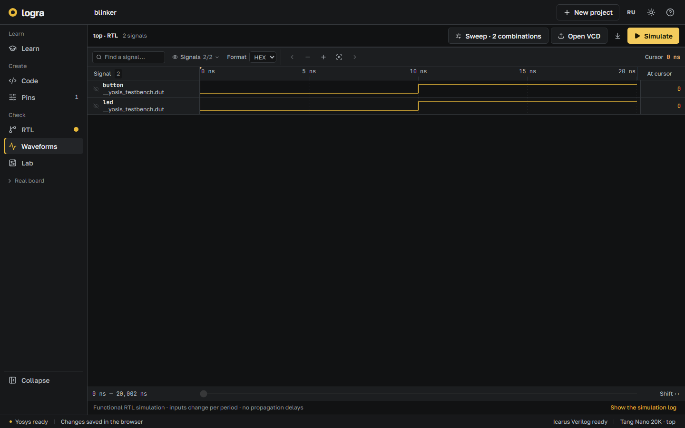</td>
  </tr>
  <tr>
    <td>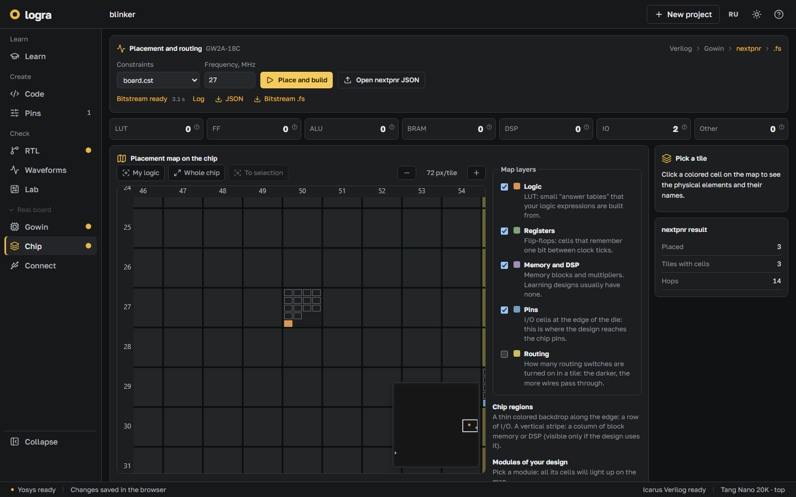</td>
    <td>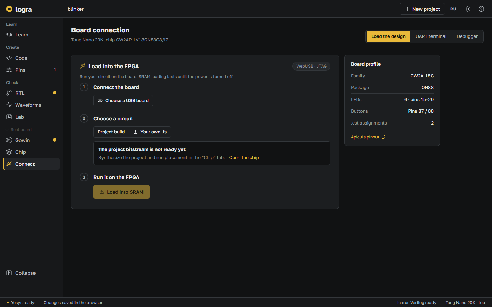</td>
  </tr>
</table>

## Two languages, phone and desktop

- **English and Russian.** The switch (`RU` / `EN`) is in the header; without a saved choice
  the language follows the browser. The whole interface, the courses, all 275 examples and the
  server messages are translated. Source code, `.cst` files and the comments inside project
  files stay as written. How it works: [docs/ARCHITECTURE.md](docs/ARCHITECTURE.md).
- **Mobile.** Below 768 px the left menu becomes a bottom tab bar, the library and properties of
  the designer become bottom sheets, and the canvas supports pinch-zoom and touch targets of at
  least 44 px. The desktop layout is unchanged. Details and screenshots:
  [docs/mobile/README.md](docs/mobile/README.md).
- **Graphite theme**, dark and light.

<table>
  <tr>
    <td>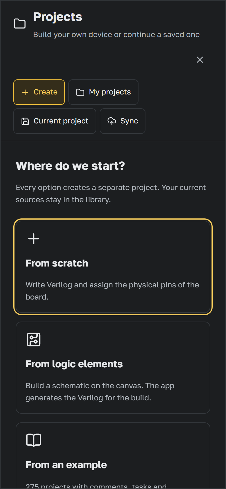</td>
    <td>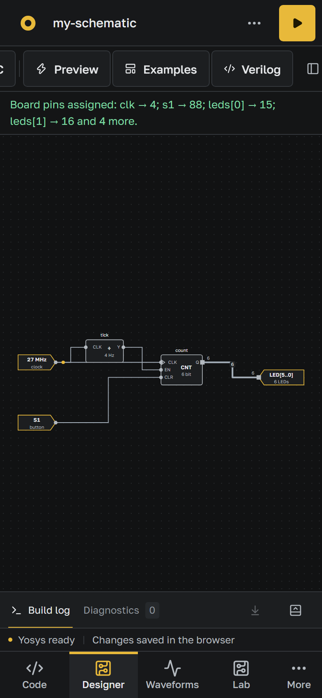</td>
  </tr>
</table>

## Designer

Draw a schematic instead of typing Verilog. The library has about 100 blocks: gates, buses,
arithmetic, flip-flops and registers, counters, decoders and encoders, memory, board buttons, LEDs
and the 27 MHz clock. Every block has a card with a symbol, an explanation and a timing diagram
or truth table. The symbols come in two notations, **ANSI** and **GOST** (the Russian standard);
switch them above the canvas. The **Verilog** tab (and the **Code** tab of a schematic project)
shows the generated code, so a schematic and its Verilog can be compared line by line.

A new schematic project starts empty. Ready-made schematics (button → LED, gates, a blinker, an
LED counter, a running light) open with one click from **Examples**; buttons and LEDs get their
board pins automatically.

## Lab

The board lies on a virtual desk. Parts are placed around it, wires go from a part pin to a
header contact, and the project runs in the browser continuously — like on the real board, only
slower.

- **85 parts**: LEDs and displays, buttons and keypads, sensors, motors and a servo, shift
  registers, OLED and LCD screens, a clock, memory and sensors on the I²C bus, a WS2812B strip,
  an ADC, a range finder, an IR remote, a PS/2 keyboard.
- **Instruments**: a logic analyser, a probe, a frequency counter, a voltmeter, a pulse
  generator, a UART terminal.
- **Real protocols**: part models answer I²C, SPI, 1-Wire and UART bit by bit, so a circuit that
  works on the desk is written the same way as for hardware.
- **Power on request**: an optional mode where each part has VCC and GND pins and must be powered
  from the board contacts.

The lab takes the pin map from the project `.cst` file, so the desk and the pin planner always
agree.

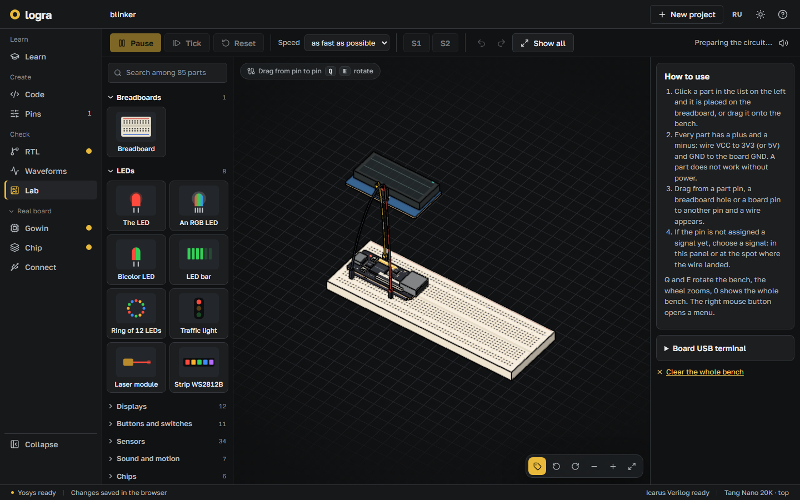

## Examples

The library has **275 ready projects** with comments in the code, pin assignments and a lesson:
the goal, what to watch and what to try changing.

- 108 designs from the first logic function to a teaching processor: adders, counters, state
  machines, UART, SPI and I²C, FIFOs, filters.
- 135 projects for the lab — at least two for every part. They open with the desk already
  assembled (the board on a breadboard, the part next to it, jumpers and power rails): press
  Start.

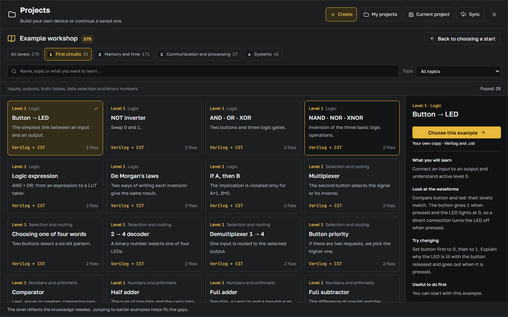

## Textbook

The [`textbook/`](textbook) folder holds the book "Digital design: from logic gates to FPGAs"
(in Russian). Part I covers combinational and sequential logic with problems and answers. Part II
covers the Tang Nano 20K, Verilog and the studio, with screenshots, seven ready projects with `.cst`
pin files and a build with open tools.

[Open the PDF](textbook/Digital_Design.pdf) · [Contents and build](textbook/README.md)

## Quick start

You need [Node.js](https://nodejs.org/) 22.13 or newer.

```sh
npm install
npm run dev
```

Open <http://127.0.0.1:5173>. Synthesis and schematics work right away: Yosys is installed with
the dependencies and runs as WebAssembly. The app opens on the "New project" window.

Two more tools are needed for the other tabs:

| What                | What for                 | How to install                                                         |
| ------------------- | ------------------------ | ---------------------------------------------------------------------- |
| Icarus Verilog      | "Waveforms", the course  | Linux: `sudo apt install iverilog` · Windows: `npm run setup:iverilog` |
| nextpnr and Apicula | "Chip" and the bitstream | `npm run setup:gowin` (needs Python 3 with `venv`; tested on 3.13)     |

Both installers put the tools into the project `.tools/` folder and change nothing in the system.
Toolchain versions in use: Yosys 0.70 (YoWASP), nextpnr-himbaechel-gowin 0.11, Apicula 0.35.

## Running on a server

On a server the app runs under [PM2](https://pm2.keymetrics.io/) on a single port:

```sh
pm2 start ecosystem.config.cjs
```

The first start installs the dependencies and builds the interface by itself. The app opens at
`http://<server-address>:4444`.

- In this mode no sign-in is needed; each browser keeps its own projects.
- Loading into the board from the browser works only over HTTPS or from `localhost` — that is how
  WebUSB is built. Put a reverse proxy with a certificate in front of the app.
- Sign-in with personal keys is enabled by `YOSIS_PUBLIC_ORIGIN` (the HTTPS address of the site)
  and `YOSIS_USERS_JSON` (name → a key of 32 characters or more).
- The number of parallel builds is set by `YOSIS_BUILD_CONCURRENCY`,
  `YOSIS_SIMULATION_CONCURRENCY` and `YOSIS_PHYSICAL_CONCURRENCY` (1 to 8). The code check
  (`/api/syntax`) and the preparation of a schematic for the lab (`/api/lab`) go through warm
  Yosys workers that serve many jobs in a row; their number is set by `YOSIS_SYNTAX_CONCURRENCY`
  and `YOSIS_LAB_CONCURRENCY` (a third of the cores by default, at most 4). Identical sources are
  checked and prepared once.

(The `YOSIS_*` variable names and the `yosis.*` browser storage keys keep the project's former
working name on purpose, so that existing deployments and pupils' saved projects keep working.)

## A real board

The "Connect" tab loads a bitstream into the chip SRAM over WebUSB — without the manufacturer's
programmer. On Windows the board's stock debugger firmware is not available to a browser, so the
same tab can install the DirtyJTAG firmware into the BL616 debugger, with a backup of the
original.

Verified on a real board: reading the debugger flash, installing the firmware, binding the WinUSB
driver and loading a bitstream into SRAM through DirtyJTAG from the browser.

Not checked against the board: the power pin positions on the headers in the lab (taken from the
pinout card), and the effect of the carry-chain fix described in
[docs/rtl-gowin-quality.md](docs/rtl-gowin-quality.md).

## How it is built

```
src/        the interface: React 19, TypeScript, Vite
  lib/lab/  the lab: a gate-level circuit simulator, part models; the 3D desk (three.js) is in components/lab/reference
  i18n/     English dictionaries (one file per area), loaded only for the English interface
server/     the Express API: queues of synthesis, simulation and placement, every job in its own process
shared/     project and result formats shared by the browser and the server; i18n core
tests/      unit tests (node:test)
e2e/        end-to-end browser tests (Playwright), including a phone layout
hardware/   the DirtyJTAG firmware sources for the BL616 debugger
textbook/   the textbook on digital design and FPGAs: LaTeX, Verilog examples, PDF
```

More in [docs/ARCHITECTURE.md](docs/ARCHITECTURE.md) (in Russian): layers, import rules, the job
protocol, environment variables. The quality of RTL generation and of the Gowin mapping, with
open upstream issues, is in [docs/rtl-gowin-quality.md](docs/rtl-gowin-quality.md).

A project goes three different ways:

1. **Synthesis** — Yosys builds the RTL and maps it onto Gowin primitives.
2. **Placement** — nextpnr lays the primitives out on the GW2AR-18 chip, Apicula builds the
   bitstream.
3. **Lab** — Yosys reduces the design to gates and flip-flops, and the browser executes them
   itself, millions of clocks per second.

## Checks

```sh
npm run check        # types
npm run lint
npm run format:check
npm run test:unit    # fast tests without external tools, seconds
npm run test:integration # with real Yosys, Icarus and Express, several minutes
npm test             # both sets
npm run test:e2e     # browser scenarios, desktop and phone layouts
npm run check:bundle # the initial JavaScript must stay below 600 KiB
```

The tests run the real tools: every lab example is synthesised and runs in the simulator with its
own desk. The same checks run on every push in GitHub Actions
([`.github/workflows/ci.yml`](.github/workflows/ci.yml)).

To refresh the screenshots in this README with the app running (`npm run dev`):
`npx tsx scripts/capture-screenshots.mts`.

## Built on

[Yosys](https://github.com/YosysHQ/yosys) ·
[YoWASP](https://yowasp.org/) ·
[nextpnr](https://github.com/YosysHQ/nextpnr) ·
[Project Apicula](https://github.com/YosysHQ/apicula) ·
[Icarus Verilog](https://steveicarus.github.io/iverilog/) ·
[DirtyJTAG for BL616](https://github.com/pepijndevos/bl616_dirtyjtag) ·
[Monaco Editor](https://microsoft.github.io/monaco-editor/) ·
[ELK](https://eclipse.dev/elk/)

Licence information for the debugger firmware is in
[`public/firmware/dirtyjtag/THIRD-PARTY-NOTICES.txt`](public/firmware/dirtyjtag/THIRD-PARTY-NOTICES.txt).
