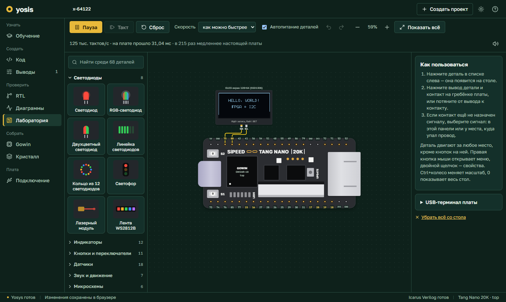
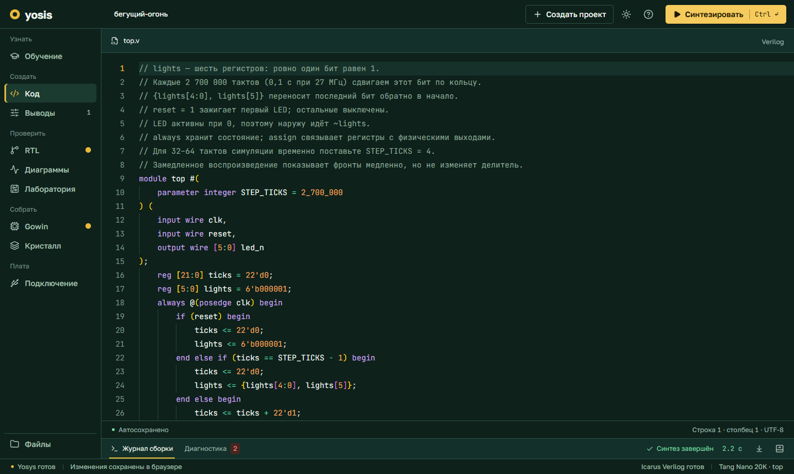
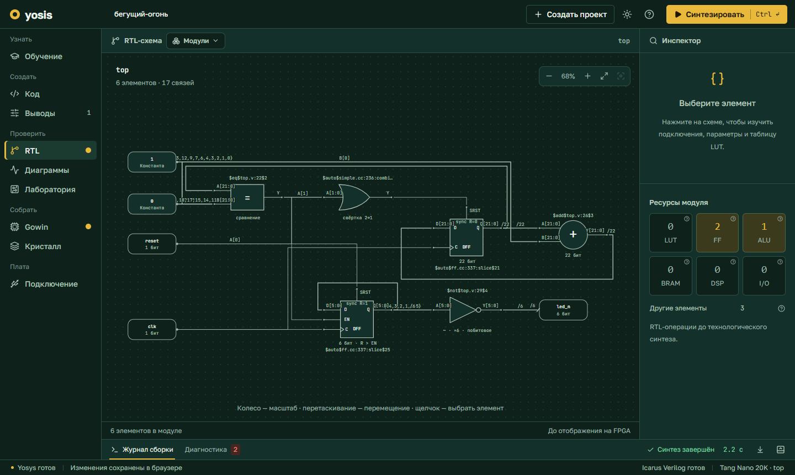
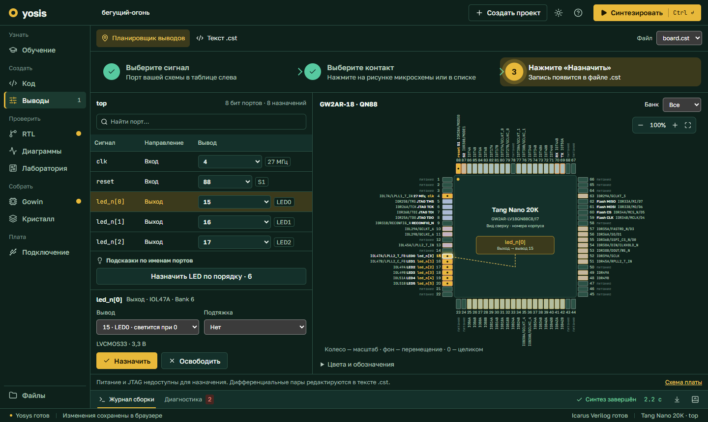
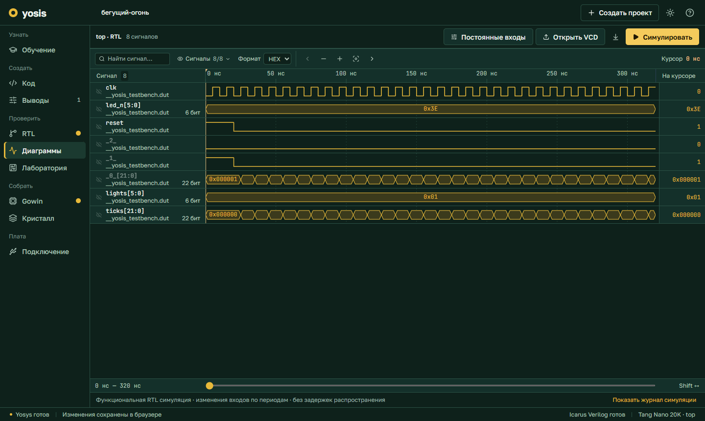
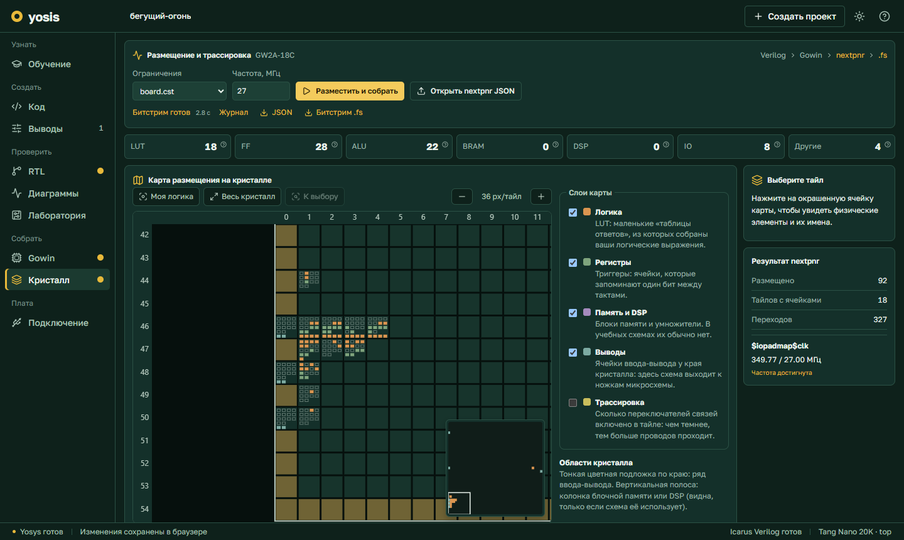
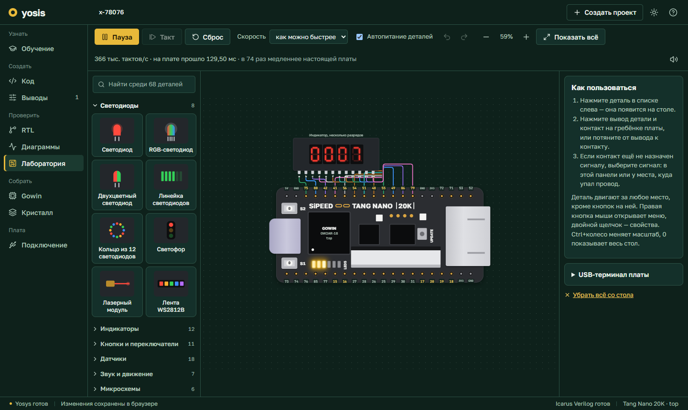
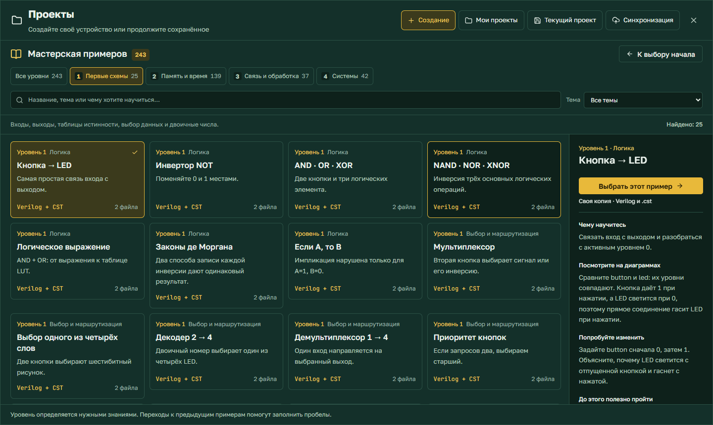

# Yosis · FPGA Studio

Учебная среда для платы **Sipeed Tang Nano 20K**, которая открывается в браузере. Она ведёт
начинающего по всему пути: написать Verilog, увидеть схему, проверить её на временной диаграмме,
собрать на виртуальном столе с деталями и загрузить в настоящую плату.

Устанавливать вендорскую IDE не нужно: синтез, размещение и симуляцию выполняют открытые
инструменты — Yosys, nextpnr, Project Apicula и Icarus Verilog.



## Что внутри

| Вкладка         | Что в ней делают                                                                                |
| --------------- | ----------------------------------------------------------------------------------------------- |
| **Обучение**    | Курс для тех, кто видит ПЛИС впервые: короткие шаги, вопросы, проверка решений симулятором      |
| **Код**         | Редактор Verilog с проверкой ошибок на лету и файлами проекта                                   |
| **Конструктор** | Сборка схемы из блоков мышью; схема превращается в Verilog                                      |
| **Выводы**      | Назначение портов на выводы корпуса QN88 с подписями, как в документации на микросхему          |
| **RTL**         | Схема из логических элементов после синтеза; переход от элемента к строке кода                  |
| **Диаграммы**   | Временные диаграммы: сценарий входов, курсор, проверка ожидаемых значений                       |
| **Лаборатория** | Плата на столе: детали, провода и схема, работающая в реальном времени                          |
| **Gowin**       | Настоящие примитивы кристалла: LUT, триггеры, блоки арифметики                                  |
| **Кристалл**    | Размещение и трассировка nextpnr, карта занятости, отчёт о частоте, битстрим `.fs`              |
| **Подключение** | Загрузка битстрима в плату прямо из браузера по WebUSB и UART-терминал                          |

<table>
  <tr>
    <td></td>
    <td></td>
  </tr>
  <tr>
    <td></td>
    <td></td>
  </tr>
  <tr>
    <td></td>
    <td></td>
  </tr>
</table>

## Лаборатория

Плата лежит на виртуальном столе. Вокруг неё ставятся детали, провода тянутся от вывода детали
к контакту гребёнки, а схема проекта исполняется в браузере непрерывно — как на настоящей плате,
только медленнее.

- **68 деталей**: светодиоды и индикаторы, кнопки и клавиатуры, датчики, моторы и сервопривод,
  сдвиговые регистры, OLED и ЖК-экраны, часы, память и датчики на шине I²C, лента WS2812B,
  АЦП, дальномер, ИК-пульт, клавиатура PS/2.
- **Приборы**: логический анализатор, пробник, частотомер, вольтметр, генератор импульсов,
  UART-терминал.
- **Настоящие протоколы**: модели деталей отвечают на I²C, SPI, 1-Wire и UART побитно, поэтому
  схема, которая работает на столе, написана так же, как для железа.
- **Питание по желанию**: можно включить режим, в котором у каждой детали есть выводы VCC и GND
  и её нужно запитать от контактов платы.

Что на каком контакте, лаборатория берёт из файла `.cst` проекта, поэтому стол и планировщик
выводов всегда согласованы.

## Примеры

В библиотеке **243 готовых проекта** с комментариями в коде, назначением выводов и уроком:
цель, что наблюдать и что попробовать изменить.

- 108 схем от первой логической функции до учебного процессора: сумматоры, счётчики, автоматы,
  UART, SPI и I²C, FIFO, фильтры.
- 135 проектов для лаборатории — не меньше двух на каждую деталь. Они открываются с уже
  собранным столом: остаётся нажать «Пуск».



## Учебное пособие

В папке [`textbook/`](textbook) лежит книга «ПЛИС на практике: Sipeed Tang Nano 20K». Она ведёт от
понятия сигнала и логических элементов до собственных проектов на Verilog, симуляции в Icarus и
встроенной SDRAM. К книге идут семь готовых проектов с файлами выводов `.cst` и сборка открытыми
инструментами.

[Открыть PDF](textbook/Tang_Nano_20K.pdf) · [Содержание и сборка](textbook/README.md)

## Быстрый старт

Нужен [Node.js](https://nodejs.org/) 22.13 или новее.

```sh
npm install
npm run dev
```

Откройте <http://127.0.0.1:5173>. Синтез и схемы работают сразу: Yosys ставится вместе с
зависимостями и запускается как WebAssembly.

Для остальных вкладок нужны ещё два инструмента:

| Что                 | Для чего                 | Как поставить                                                                    |
| ------------------- | ------------------------ | -------------------------------------------------------------------------------- |
| Icarus Verilog      | «Диаграммы», курс        | Linux: `sudo apt install iverilog` · Windows: `npm run setup:iverilog`           |
| nextpnr и Apicula   | «Кристалл» и битстрим    | `npm run setup:gowin` (нужен Python 3 с `venv`; проверено на Python 3.13)        |

Оба установщика кладут инструменты в папку `.tools/` проекта и ничего не меняют в системе.

## Запуск на сервере

На сервере приложение работает под [PM2](https://pm2.keymetrics.io/) на одном порту:

```sh
pm2 start ecosystem.config.cjs
```

Первый запуск сам ставит зависимости и собирает интерфейс. Приложение открывается на
`http://<адрес-сервера>:4444`.

- В этом режиме вход не требуется; проекты каждого браузера хранятся отдельно.
- Загрузка в плату из браузера работает только по HTTPS или с `localhost` — так устроен WebUSB.
  Поставьте перед приложением обратный прокси с сертификатом.
- Вход по персональным ключам включают переменные `YOSIS_PUBLIC_ORIGIN` (HTTPS-адрес сайта) и
  `YOSIS_USERS_JSON` (имя → ключ от 32 символов).
- Число одновременных сборок задают `YOSIS_BUILD_CONCURRENCY`, `YOSIS_SIMULATION_CONCURRENCY`
  и `YOSIS_PHYSICAL_CONCURRENCY` (от 1 до 8).

## Настоящая плата

Вкладка «Подключение» загружает битстрим в SRAM кристалла через WebUSB — без программатора
производителя. На Windows штатная прошивка отладчика платы недоступна браузеру, поэтому в той
же вкладке есть установка прошивки DirtyJTAG в отладчик BL616 с резервной копией исходной.

Проверено на настоящей плате: чтение флеш-памяти отладчика, установка прошивки, привязка
драйвера WinUSB и загрузка битстрима в SRAM через DirtyJTAG из браузера.

Не сверено с платой: расположение контактов питания на гребёнках в лаборатории — оно взято
с карточки распиновки.

## Как это устроено

```
src/        интерфейс: React 19, TypeScript, Vite
  lib/lab/  лаборатория: симулятор вентильной схемы, модели деталей, трассировка проводов
server/     API на Express: очереди синтеза, симуляции и размещения, каждое задание в своём процессе
shared/     форматы проекта и результатов, общие для браузера и сервера
tests/      юнит-тесты (node:test)
e2e/        сквозные тесты в браузере (Playwright)
hardware/   исходники прошивки отладчика DirtyJTAG для BL616
textbook/   учебное пособие по ПЛИС: LaTeX, примеры на Verilog, PDF
```

Схема проекта проходит три разных пути:

1. **Синтез** — Yosys строит схему RTL и отображает её на примитивы Gowin.
2. **Размещение** — nextpnr раскладывает примитивы по кристаллу GW2AR-18, Apicula собирает
   битстрим.
3. **Лаборатория** — Yosys сводит схему к вентилям и триггерам, а браузер исполняет их сам,
   миллионы тактов в секунду.

## Проверки

```sh
npm run check        # типы
npm run lint
npm test             # 596 юнит-тестов
npm run test:e2e     # 7 сценариев в браузере
```

Тесты запускают настоящие инструменты: каждый пример лаборатории синтезируется и работает
в симуляторе со своим столом.

## На чём это стоит

[Yosys](https://github.com/YosysHQ/yosys) ·
[YoWASP](https://yowasp.org/) ·
[nextpnr](https://github.com/YosysHQ/nextpnr) ·
[Project Apicula](https://github.com/YosysHQ/apicula) ·
[Icarus Verilog](https://steveicarus.github.io/iverilog/) ·
[DirtyJTAG для BL616](https://github.com/pepijndevos/bl616_dirtyjtag) ·
[Monaco Editor](https://microsoft.github.io/monaco-editor/) ·
[ELK](https://eclipse.dev/elk/)

Сведения о лицензиях прошивки отладчика лежат в
[`public/firmware/dirtyjtag/THIRD-PARTY-NOTICES.txt`](public/firmware/dirtyjtag/THIRD-PARTY-NOTICES.txt).
