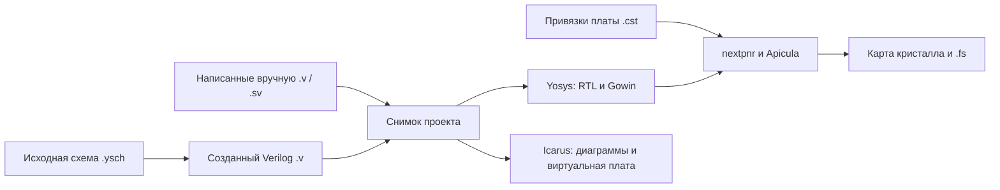

> Реализация 4 октября: одна схема .ysch на проект, 18 типов элементов, 1–64 бит, undo/redo, сохранение черновиков, строгий генератор Verilog и сквозной тулчейн. Не реализованы пользовательские подмодули, поворот/группы/ручная трасса, память/PLL/DSP и произвольные домены такта. Генерируемый .v передаётся работникам сборки; он не хранится вторым редактируемым источником в Project.files.

# Визуальное создание RTL и привязка к плате

Статус: архитектурный план. Редактор, в котором можно собирать устройство из блоков и соединений, реализован в первой версии 4 октября 2026. Этот документ сохраняет концепт и критерии следующих расширений.

Цель: ученик собирает схему, задаёт входы и выходы, связывает их с кнопками, LED и тактом Tang Nano 20K, затем использует существующие синтез, диаграммы, виртуальную плату и карту кристалла.

## 1. Два документа схемы

Текущий формат: `{ format: 'yosis-schematic', version: 1, nodes, wires }`; имя верхнего модуля хранится в `Project.top`. Каждый узел имеет постоянный ID, тип, имя, ширины/срез/значение/сброс/enable и координаты. Каждая связь соединяет `from: {node, pin}` с `to: {node, pin}`; разветвление — несколько связей одного выхода. Состав будущей модели ниже — план расширения, а не описание обязательных полей текущего файла.

Нужен отдельный **исходный документ схемы**, из которого Yosis получает Verilog. Вкладка **RTL** продолжает показывать результат обработки исходников Yosys. Внутреннее представление Yosys включает ячейки, провода и процессы; синтез преобразует процессы и может менять состав схемы. Поэтому сохранение результата Yosys как единственного редактируемого исходника потеряет исходные решения ученика. Основание: [представление RTLIL](https://yosyshq.readthedocs.io/projects/yosys/en/latest/yosys_internals/formats/rtlil_rep.html).

Предлагаемый путь данных:



Во всех случаях источники и результаты относятся к конкретному снимку проекта. Изменение схемы делает предыдущие синтез и симуляцию устаревшими, как сейчас изменение Verilog.

## 2. Как это будет выглядеть

В мастере создания проекта появится способ описания: **Verilog** или **Схема**. Для схемы первый выбор — «Кнопка → LED», «Логические элементы» или «Счётчик». Название, верхний модуль и плата задаются тем же мастером. В мастере доступен вариант «Из логических элементов».

У файлов будет общий менеджер:

| Открываемый файл | Рабочее представление |
| --- | --- |
| `.v`, `.sv`, `.vh`, `.svh` | Код |
| `.cst` | Выводы |
| `.ysch` | Конструктор схемы |
| Созданный схемой `.v` | Код с отметкой «Создано из схемы» |

«Конструктор» открывается как представление выбранного документа. В нём находятся палитра блоков, холст и свойства выбранного элемента. Справочные карточки и SVG-обозначения используются совместно с инспектором RTL. Выбор входа или выхода предлагает действие «Назначить вывод платы», которое открывает существующую вкладку выводов с выбранным сигналом.

Школьнику не нужно сразу видеть параметры Yosys. Например, свойство регистра показывается как «6 бит», «Положительный фронт», «Сброс при 0», «Сброс → 0», «Разрешение при 1».

## 3. Формат исходной схемы

Предлагаемое расширение `.ysch` хранит JSON с явной версией формата. Один файл описывает один модуль. Координаты и повороты относятся только к оформлению и не меняют функцию устройства.

Минимальные сущности:

| Сущность | Обязательные данные |
| --- | --- |
| Документ | `format`, `version`, `moduleName`, путь создаваемого `.v` |
| Порт модуля | постоянный ID, имя, направление, число бит, роль `data` / `clock` / `reset` |
| Блок | постоянный ID, тип из каталога, экземпляр, параметры, расположение |
| Соединение | постоянный ID, один источник и список потребителей |
| Конечная точка | ID блока или внешнего порта, имя контакта |
| Оформление | подписи, расположение блоков, ручные точки трассировки |

ID сохраняется при переименовании и перемещении. Имя в Verilog выбирается отдельно и проверяется на допустимый идентификатор, ключевые слова и повторения. Имена системных ячеек `$mux` или `$dff` не являются типами исходных блоков: каталог использует `mux2`, `register`, `and` и другие понятные имена.

Формат содержит только данные. Загружаемый JSON не может добавлять JavaScript, исполняемые выражения параметров или команды инструментов. Параметры первой версии — целые числа, логические значения и константы фиксированной ширины.

Первая версия `Project.files` принимает HDL, `.cst` и `.ysch`. Для `.ysch` нужно изменить общую валидацию, импорт/экспорт, сохранение, менеджер файлов и построение снимков на клиенте и сервере. Старые проекты должны открываться без потери файлов и правок. Неподдерживаемая версия схемы возвращает понятную ошибку, а не пустой холст.

Начальные ограничения: 40 файлов и 2 МБ на проект остаются общими; до 200 блоков на одну учебную схему; ширина данных — от 1 до 64 бит. Они проверяются при импорте и при редактировании.

## 4. Первая палитра: точная семантика

Первая версия работает с беззнаковыми шинами `[W-1:0]`. Соединения с разной шириной требуют явного блока преобразования.

| Блок | Контакты | Поведение |
| --- | --- | --- |
| Вход | `Y: W` | Значение внешнего входа модуля |
| Выход | `A: W` | Значение внешнего выхода модуля |
| Константа | `Y: W` | Заданное значение в диапазоне `0..2^W-1` |
| NOT | `A: W`, `Y: W` | Побитовая инверсия `~A` |
| AND / OR / XOR | `A: W`, `B: W`, `Y: W` | Побитовая операция |
| Мультиплексор 2:1 | `A: W`, `B: W`, `S: 1`, `Y: W` | При `S=0` выбирает A, при `S=1` выбирает B |
| Сумматор / вычитатель | `A: W`, `B: W`, `Y: W` | Результат по модулю `2^W`; перенос за пределами W теряется |
| Равно | `A: W`, `B: W`, `Y: 1` | Сравнение `A == B` |
| Срез шины | `A: W`, `Y: K` | Явный диапазон `[hi:lo]`, `0 ≤ lo ≤ hi < W`, `K=hi-lo+1` |
| Объединение шин | `A: Wa`, `B: Wb`, `Y: Wa+Wb` | `{A, B}`: A занимает старшие биты |
| Дополнение нулями | `A: Wa`, `Y: Wy` | `Wy > Wa`; новые старшие биты равны 0 |
| Регистр | `D: W`, `Q: W`, `CLK: 1`; опционально `RST: 1`, `EN: 1` | Сохраняет D на положительном фронте; синхронный сброс имеет приоритет над EN |

У мультиплексора надписи «0» и «1» у входов остаются видимыми. Такая семантика соответствует [обычному мультиплексору Yosys](https://yosyshq.readthedocs.io/projects/yosys/en/latest/cell/word_mux.html). Параллельный `$pmux` с выбором one-hot остаётся темой справки RTL; добавлять его в первую учебную палитру не нужно.

Счётчик в учебном шаблоне собирается из регистра, сумматора и константы 1. Ученик может раскрыть его и увидеть обратную связь. Позднее из этой группы можно создать пользовательский подмодуль.

Память, PLL, DSP, двунаправленные выводы, три состояния, асинхронные защёлки, несколько тактовых доменов и знаковая арифметика требуют отдельных правил и примеров. Они добавляются после первой палитры.

## 5. Соединения и ошибки до генерации

Проверки выполняются на модели схемы, независимо от SVG:

1. Источник — выход блока или вход внешнего модуля; потребитель — вход блока или выход внешнего модуля. Само название «вход» зависит от этой границы и объясняется в интерфейсе.
2. У каждого потребляемого бита есть ровно один источник. Один источник можно разветвлять на любое число потребителей. Соединение двух выходов запрещено.
3. Все обязательные входы соединены. Неиспользуемый выход блока допускается с предупреждением. Значение несоединённого входа не подставляется автоматически.
4. Ширины совпадают. Обрезание, перестановка и дополнение шины показываются отдельными блоками; редактор не угадывает их.
5. Проверяется отсутствие чисто комбинационных циклов. Ребро через путь `D → Q` регистра разрывает комбинационную зависимость; петля `Q → сумматор → D` законна. Петля `NOT → NOT` вызывает ошибку с подсветкой всего пути.
6. `CLK` подключается только к внешнему однобитному входу, помеченному как такт. Все регистры первой версии используют один такой вход. «Замедлить устройство» предлагается через разрешение обновления EN, а не через комбинационный вентиль в цепи CLK.
7. Дублирующиеся имена портов, блоков и модулей запрещены. Срезы проверяются после каждого изменения ширины.

Первая версия соединяет целые контакты. Частичные соединения моделируются срезами и объединением шин, поэтому нет неоднозначности между несколькими назначениями разных частей одной шины.

После генерации Yosys дополнительно запускает `hierarchy -check`, обработку процессов и `check -assert`: собственная проверка холста не заменяет проверку HDL. Команда `check` ищет комбинационные циклы, конфликтующие источники и используемые сигналы без источника. Основание: [документация check](https://yosyshq.readthedocs.io/projects/yosys/en/v0.50/cmd/check.html).

## 6. Такт, сброс и состояние регистра

В первой версии регистр срабатывает на положительном фронте. Значение сброса — постоянное W-битное число; уровень RST и EN задаётся отдельно. Сброс синхронный: нажатие кнопки меняет Q только на следующем фронте. Для активного при 0 сброса и EN при 1 генератор создаёт:

```verilog
always @(posedge clk) begin
    if (!reset_n)
        q <= 6'd0;
    else if (enable)
        q <= d;
end
```

При EN=0 регистр сохраняет значение. Если EN отсутствует, ветка `else` обновляет Q без проверки EN. Если RST отсутствует, начальное Q в функциональной симуляции неизвестно до первого присваивания. Редактор не вводит скрытый `initial`, чтобы сделать LED определёнными.

Различие синхронного и асинхронного сброса, полярность и порядок RST/EN показаны в [справке регистров Yosys](https://yosyshq.readthedocs.io/projects/yosys/en/latest/cell/word_reg.html). Асинхронный вариант появится позже с отдельным обозначением и тестами при изменении RST между фронтами.

Кнопка на реальной плате является внешним асинхронным сигналом. Учебный каталог позднее получит раскрываемые модули синхронизации и устранения дребезга. Функциональная виртуальная плата показывает заданные уровни кнопки; она не моделирует метастабильность или реальный дребезг.

## 7. Генерация Verilog и владение исходниками

Схема владеет конкретным создаваемым файлом, например `_generated/top.v`. Генерация должна быть детерминированной: одинаковая схема даёт одинаковый текст, независимо от расположения блоков и порядка ключей JSON. Стабильные ID задают внутренние имена; перестановка блоков на холсте не переименовывает провода.

Нужны явные сведения о владельце создаваемого файла и хеш его последней генерации. Не следует определять владение только по имени папки. При импорте проекта или перед сборкой редактор сверяет текст с хешем. Если файл изменён вне редактора, требуется устранить конфликт: восстановить генерацию из сохранённой схемы либо сохранить отредактированный текст как самостоятельный HDL-модуль с новым именем. Не затирать правки и не отправлять одновременно две реализации одного модуля на сборку.

Созданный `.v` по умолчанию открывается только для чтения. Действие **«Сделать копию для редактирования»** явно отделяет копию от схемы и предлагает новое имя модуля. Для передачи в обычный HDL-проект доступен экспорт созданных исходников.

Генератор использует ANSI-порты, явно размеренные константы, отдельные wire и `assign` для комбинационных блоков, `reg` и неблокирующие присваивания для регистров. Для всего файла включается `default_nettype none`; после него режим возвращается к `wire`, чтобы не влиять на другие исходники проекта. У сумматора W-битные аргументы и W-битный результат соответствуют объявленной модульной арифметике.

Одна функция подготовки проекта используется синтезом, симуляцией и физической сборкой. Сервер повторно проверяет `.ysch` и получает тот же Verilog; содержимое создаваемого `.v` не считается доверенным обходом проверки. Снимок запуска содержит исходную схему, созданный HDL, `.cst`, версии генератора и каталогов, а также хеши. Размещение продолжает использовать отдельный плоский нетлист.

Генератор дополнительно возвращает таблицу `блок → файл и строки`. Диагностика инструментов ссылается на соответствующий блок; просмотр созданного кода подсвечивает его строки. После оптимизации несколько блоков могут превратиться в одну ячейку или исчезнуть. Связь с синтезированными элементами строится только по сохранившимся исходным ссылкам Yosys; точное взаимно однозначное соответствие не обещается.

## 8. Иерархия и существующие HDL-модули

Первый рабочий этап — одна схема верхнего модуля. Следующий — экземпляры схем других модулей: порт экземпляра всегда наследует направление и ширину из документа модуля. Рекурсивные ссылки запрещены. Изменение интерфейса подмодуля показывает все затронутые экземпляры и не удаляет соединения молча.

При поиске комбинационных циклов через иерархию нужен сводный граф зависимости входов и выходов подмодуля. Считать любую «коробку» границей памяти нельзя: внутри может быть только комбинационная логика. Итоговая проверка Yosys остаётся обязательной.

HDL-модуль позднее можно вставить как блок. Его интерфейс берётся из успешной обработки текущих исходников Yosys; модуль, параметры и хеш источника сохраняются в экземпляре. Изменение HDL требует повторной проверки интерфейса. Код внутри блока продолжает редактироваться как код. Параметризованные экземпляры нужно добавлять после тестов изменения ширин при обработке параметров.

## 9. Контракт платы и `.cst`

Контракт платы описывает соответствие **логический порт/бит → функция платы → вывод FPGA**. Для первого этапа каталог содержит только проверенные встроенные ресурсы Tang Nano 20K:

| Функция | Вывод FPGA | Направление на границе проекта |
| --- | --- | --- |
| Такт 27 МГц | 4 | Вход |
| Кнопки | 87, 88 | Вход |
| LED0…LED5, светятся при 0 | 15…20 | Выход |

Распиновка сверяется с [примером Apicula](https://github.com/YosysHQ/apicula/blob/master/examples/tangnano20k.cst); частота и активный низкий уровень LED — с [документацией Sipeed](https://wiki.sipeed.com/hardware/en/tang/tang-nano-20k/nano-20k.html). Каталог хранит ссылку и версию описания платы. Произвольные выводы разъёмов добавляются после проверки номера корпуса, банка, напряжения и занятых на плате цепей.

Например, ученик назначает `led_n[0]` на LED0. В `board.cst` появляются понятный комментарий, `IO_LOC "led_n[0]" 15;` и `IO_PORT "led_n[0]" IO_TYPE=LVCMOS33;`. Каждый бит шины получает собственное назначение. Для такта добавляется поддерживаемое назначение глобального буфера. Целевая частота физической сборки остаётся отдельным значением её конфигурации; команда `IO_LOC` не задаёт период такта.

Полярность LED и кнопок — часть объяснения контракта. Назначение вывода не добавляет инвертор в RTL незаметно. Если схема выдаёт `lit=1` для включённого света, мастер предлагает вставить видимый NOT перед портом физического LED. Виртуальная плата может использовать ту же информацию о привязках и полярности, сохраняя возможность ручного выбора.

Для `.cst` нужен один источник истины: текст файла. Табличный редактор читает поддерживаемые команды и изменяет их с сохранением комментариев и неизвестных директив. При неоднозначных или дублирующихся назначениях он показывает проблему и предлагает исправить текст; не пересоздаёт файл целиком и не удаляет ручные ограничения.

Проверки перед физической сборкой:

- назначаемый порт существует в актуальном верхнем модуле;
- указан существующий бит шины;
- нет двух логических сигналов на одном выводе и двух выводов у одного сигнала;
- направление соответствует выбранному встроенному ресурсу;
- для первого каталога используется проверенный стандарт LVCMOS33;
- все внешние биты назначены; неполные привязки не мешают симуляции, но блокируют запрос физической сборки;
- физическая сборка использует именно выбранный `.cst`, если в проекте их несколько.

## 10. Обратное преобразование

Надёжный первый поток: **схема → Verilog → существующие инструменты**. Загрузка сохранённого `.ysch` полностью восстанавливает схему, включая оформление.

Произвольный Verilog и оптимизированный JSON Yosys не восстанавливают авторскую схему, её подписи и выбранные блоки. Они продолжают открываться в текущем просмотрщике RTL. Позже можно отдельно предложить создание новой схемы из ограниченного набора распознанных элементов. Это будет новый документ с отчётом о неподдерживаемых ячейках и проверкой поведения, а не скрытое переключение источника существующего проекта.

## 11. Этапы реализации и критерии готовности

### Этап A. Модель и генератор

Добавить общий формат, чистые функции проверки, каталог первой палитры, генератор и миграцию проекта. UI пока не требуется.

Критерии:

- фиксированные схемы NOT, AND/OR, MUX и шестибитного счётчика дают корректный Verilog;
- все комбинации маленьких входов проверяются настоящим Icarus;
- у счётчика проверяются сброс, пауза, переполнение и точный фронт обновления;
- отрицательные случаи отклоняются: две линии на входе, неверная ширина, несоединённый вход, комбинационная петля, неверный CLK;
- перемещение блоков не меняет HDL; переименование подписи не ломает ссылки;
- экспорт/импорт сохраняет граф, а изменение производного `.v` обнаруживается.

### Этап B. Редактор одного модуля

Добавить создание блоков, соединения, выбор, удаление, перемещение, отмену/повтор, клавиатурные действия и понятные свойства. ELK используется для команды авторазмещения; ручные координаты сохраняются. Не использовать перестроение результата Yosys как механизм редактирования.

Критерий: новый проект из мастера можно собрать на холсте, сохранить, перезагрузить, исправить и снова симулировать без редактирования текста HDL. Ошибки выделяют конкретный контакт или путь.

### Этап C. Привязки и полный проход

Добавить каталог платы и табличное изменение `.cst`; открыть созданные исходники через общий менеджер. Все виды запуска используют один подготовленный снимок.

Критерий: визуальные NOT, MUX и счётчик проходят Yosys, Icarus, nextpnr и Apicula; каждый внешний бит назначен, неразмещённых ячеек нет, карта кристалла строится из реальных результатов. Изменение графа или `.cst` не оставляет старую сборку обозначенной как актуальная.

### Этап D. Подмодули и уроки

Добавить повторное использование схем, раскрываемые шаблоны, затем экземпляры HDL-модулей. Превратить первые упражнения в задания «собери из элементов» с проверкой поведения.

Критерий: один подмодуль можно использовать дважды; сохранение и изменение его интерфейса корректно затрагивают оба экземпляра; циклы через комбинационный подмодуль обнаруживаются. HDL внутри экземпляра проверяется по текущим исходникам.

## 12. Сверка с исходным планом

Текущие синтез, диаграммы, виртуальная плата, примеры с `.cst` и реальная карта кристалла уже дают основу. Конструктор добавляется перед этим потоком и не требует переписывать инструментальные сервисы.

Из [исходного плана](implementation-plan.md) остаются самостоятельные этапы:

| Работа | Что можно выполнить без платы | Что требует платы |
| --- | --- | --- |
| Локальный помощник openFPGALoader | протокол запуска, выбор артефакта, обработка ошибок, проверки с имитацией процесса | обнаружение BL616 и настоящая загрузка/проверка SRAM |
| WebUSB/JTAG | изучение и реализация протокола, тестовые обмены | реальное устройство, разрешения браузера и успешная прошивка |
| Пользовательские testbench | редактор, запуск, диагностика, VCD и проверки ожидаемых значений | аппаратная сверка отдельных проектов |
| Маршрут выбранного сигнала | чтение артефактов nextpnr и отображение связи на карте | аппаратный доступ для разработки просмотра не нужен |
| Учебная программа | дополнительные задания и сохранение прогресса | проверка уроков с реальными кнопками и LED |
| RISC-V/BRAM/UART, затем SDRAM | HDL/C toolchain, программные образы и симуляция конкретной конфигурации | подтверждение загрузки и работы на Tang Nano 20K, особенно SDRAM |

Эти пункты нельзя помечать завершёнными на основании интерфейса или имитации оборудования. Для каждого отдельно фиксируются программная проверка и аппаратный результат. Первый конструктор можно довести до реального битстрима и карты кристалла на имеющихся локальных инструментах.
